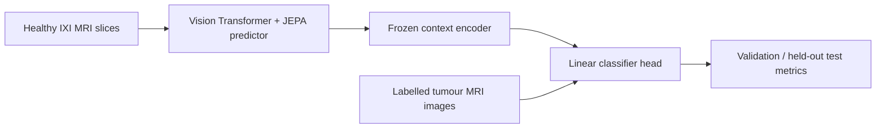

# NeuroJEPA

NeuroJEPA is a research prototype for self-supervised brain MRI representation learning followed by four-class tumour classification. It is **not** a clinically validated diagnostic system.

## Workflow



## Verified data and environment

- IXI processed slices currently containing 122 PNG files under `datasets/processed/ixi/slices` (not all expected folders were present in this workspace snapshot).
- Tumour dataset: `Epic and CSCR hospital Dataset` in the user's Downloads folder.
- Training images: 9,650 total: glioma 3,018; meningioma 2,183; notumor 1,945; pituitary 2,504.
- Test images: 2,414 total: glioma 755; meningioma 546; notumor 487; pituitary 626.
- Current PyTorch is CPU-only (`2.13.0+cpu`); CUDA is unavailable. Training remains supported on CPU.
- Images are converted to grayscale, resized to 224 × 224, and converted to a `[1, 224, 224]` tensor.

## Usable checkpoints

| Checkpoint | Status |
|---|---|
| `checkpoints/jepa_ixi_experiment_100.pth` | JEPA pretraining checkpoint, step metadata 100 |
| `checkpoints/jepa_tumor_classifier_100step.pth` | Loads strictly and passes a forward-pass smoke test; encoder tensors exactly match the 100-step JEPA context encoder; recorded validation accuracy 0.4797927461 |
| `checkpoints/jepa_tumor_classifier_weighted.pth` | Loads strictly; 10-step source metadata; recorded validation accuracy 0.4590673575 |
| `checkpoints/jepa_tumor_classifier.pth` | Loads strictly; 10-step source metadata; recorded validation accuracy 0.4227979275 |

The final classifier training logs for the 100-step run are not available, so epoch-wise metrics and complete per-class validation metrics are not claimed.

## Environment setup

```powershell
python -m venv .venv
.\.venv\Scripts\Activate.ps1
python -m pip install -U pip
python -m pip install -r requirements.txt
```

Verified environment: Python 3.13.3, CPU-only PyTorch 2.13.0, and torchvision 0.28.0. Supply tumour and IXI paths explicitly with `--data-dir`.

## Pretraining

```powershell
python training/train_jepa.py --data-dir "path\to\processed\ixi" --steps 100 --batch-size 1 --masking-strategy random
```

## Training

From the repository root:

```powershell
python training/train_classifier.py --data-dir "C:\Users\admin\Downloads\brain_tumor_dataset\Epic and CSCR hospital Dataset" --checkpoint checkpoints/jepa_ixi_experiment_100.pth --output checkpoints/jepa_tumor_classifier_new.pth --epochs 5 --batch-size 16 --seed 42
```

Random initialized encoder baseline with the same classifier head and split:

```powershell
python training/train_classifier.py --data-dir "C:\Users\admin\Downloads\brain_tumor_dataset\Epic and CSCR hospital Dataset" --random-encoder --output checkpoints/jepa_tumor_classifier_random_baseline.pth --epochs 5 --batch-size 16 --seed 42
```

## Evaluation

Evaluate only after final model selection. Earlier work did evaluate the test folder, so current test results cannot be treated as fully unseen:

```powershell
python evaluation/evaluate_classifier.py --checkpoint checkpoints/jepa_tumor_classifier_100step.pth --data-dir "C:\Users\admin\Downloads\brain_tumor_dataset\Epic and CSCR hospital Dataset\Test" --batch-size 16 --output-prefix evaluation/jepa_100step_test
```

The label-efficiency specification is reproducible and records its requested proportions without fabricating results:

```powershell
python evaluation/label_efficiency.py --data-dir "path\to\Epic and CSCR hospital Dataset" --checkpoint checkpoints\jepa_ixi_experiment_100.pth --fractions 0.10 0.25 0.50 1.0 --epochs 1 --batch-size 16 --seed 42
python evaluation/random_baseline_label_efficiency.py --data-dir "path\to\Epic and CSCR hospital Dataset" --epochs 1 --batch-size 16 --seed 42
```

## Actual 100-step checkpoint evaluation

A real-data evaluation of the existing `jepa_tumor_classifier_100step.pth` produced the following test metrics (the test folder may have been used previously, so this is not claimed as independent-held-out validation):

- Accuracy: 0.4399
- Macro F1: 0.4387
- glioma: precision 0.6457, recall 0.4225, F1 0.5108
- meningioma: precision 0.2563, recall 0.4469, F1 0.3258
- notumor: precision 0.3756, recall 0.2977, F1 0.3322
- pituitary: precision 0.6082, recall 0.5655, F1 0.5861

## Inference demo

A compatible grayscale or RGB image can be classified with the real checkpoint:

```powershell
python app.py --image "path\to\mri.png" --checkpoint checkpoints/jepa_tumor_classifier_100step.pth
```

Probabilities are actual softmax outputs from the loaded classifier. Missing checkpoints, unreadable files, and invalid model data produce explicit errors.

## Label-efficiency comparison

Frozen JEPA versus randomly initialized encoder, using one CPU epoch, batch size 16, seed 42, the same sample subsets, and the shared 965-image validation split. Test data was not used.

| Labels | Samples | JEPA accuracy | Random accuracy | Accuracy difference | JEPA macro F1 | Random macro F1 | F1 difference |
|---|---:|---:|---:|---:|---:|---:|---:|
| 10% | 869 | 0.4477 | 0.4456 | 0.0021 | 0.4308 | 0.3851 | 0.0457 |
| 25% | 2,171 | 0.3865 | 0.4238 | 0.0373 | 0.3080 | 0.3960 | 0.0880 |
| 50% | 4,343 | 0.4259 | 0.4736 | 0.0477 | 0.3668 | 0.4306 | 0.0638 |
| 100% | 8,685 | 0.4155 | 0.5047 | 0.0891 | 0.3979 | 0.5055 | 0.1076 |

Per-class recall (JEPA / random):

| Labels | Glioma | Meningioma | Notumor | Pituitary |
|---|---:|---:|---:|---:|
| 10% | 0.5694 / 0.6667 | 0.3594 / 0.0968 | 0.2864 / 0.2524 | 0.5157 / 0.6496 |
| 25% | 0.4236 / 0.4410 | 0.0184 / 0.1152 | 0.1553 / 0.6505 | 0.8465 / 0.4843 |
| 50% | 0.5417 / 0.5903 | 0.1429 / 0.0922 | 0.1456 / 0.5243 | 0.7638 / 0.6260 |
| 100% | 0.3229 / 0.3333 | 0.4747 / 0.6221 | 0.2136 / 0.4903 | 0.6339 / 0.6102 |

Outputs: `evaluation/final_comparison/final_comparison.json`, `evaluation/final_comparison/final_comparison.csv`, and `evaluation/final_comparison/final_comparison.png`.

These are exploratory one-epoch CPU measurements, not converged benchmark evidence; non-monotonic curves should not be interpreted as data harming performance.

## Limitations

- CPU-only execution; the GeForce MX550 is not currently usable by PyTorch.
- Frozen-encoder experiments do not test full ViT fine-tuning.
- The label-efficiency experiments are exploratory one-epoch CPU runs; converged multi-epoch runs and confidence intervals remain future work.
- The test folder was used in earlier experiments and cannot be considered untouched for all reported checkpoints.
- Dataset provenance and medical suitability must be independently verified before use outside a research setting.

## Final comparison

The final classifier training logs for the 100-step run are not available, so epoch-wise metrics and complete per-class validation metrics are not claimed.

## Web application

```powershell
streamlit run web_app.py
```

The dashboard uses `checkpoints/jepa_tumor_classifier_100step.pth`, CPU inference, grayscale conversion, and the existing 224×224 preprocessing. It is an experimental academic interface and not a clinical diagnostic tool.